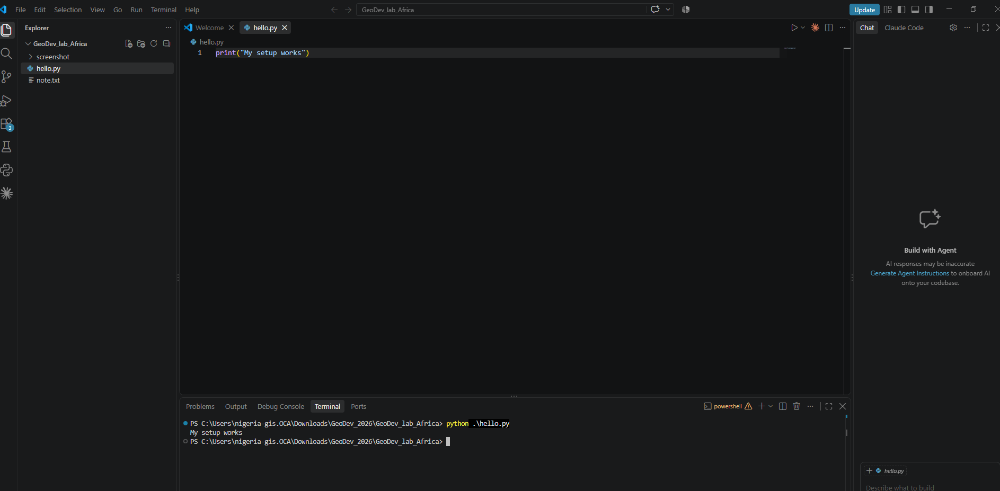

# My GeoDev Lab Africa Project
Which wards in Wamako LGA, Sokoto State are 5km from a health Facility?
Built over twelve months with GeoDev Lab Africa, Cohort one.
See [project-brief.md](project-brief.md) for the full brief.


## Project structure

```
flood-mapping-mitigation/
├── docs/
│   ├── 01-project-brief.md        Week 1
│   ├── 02-data-notes.md           Week 2
│   ├── 03-data-preparation.md     Week 3
│   └── 04-month-1-summary.md      Week 4
├── data/
│   ├── raw/                       downloaded, not committed
│   └── processed/                 output
├── scripts/
│   ├── hello.py                   Week 5
│   └── check.py                   Week 6
├── screenshots/
│   ├── week5.png                  Week 5
│   └── week6.png                  Week 6
└── requirements.txt
```


## Progress

- [x] Week 1: project brief with a source link for every dataset
- [x] Week 2: data downloaded, opened, and described
- [x] Week 3: reprojected, clipped, and quality check
- [ ] Week 4: first spatial analysis
- [x] Week 5: `hello.py` runs
- [x] Week 6: `main.py` runs 

# Month 2: Development Environment and Early Python
  -  Week 5: Setup Python, VS Code, and the Terminal. `hello.py` runs

  -  Week 5: Setup Python, VS Code, and the Terminal. 'main.py' runs
